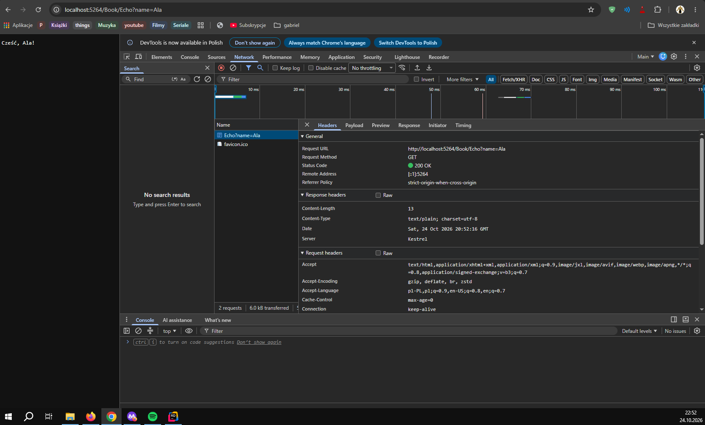
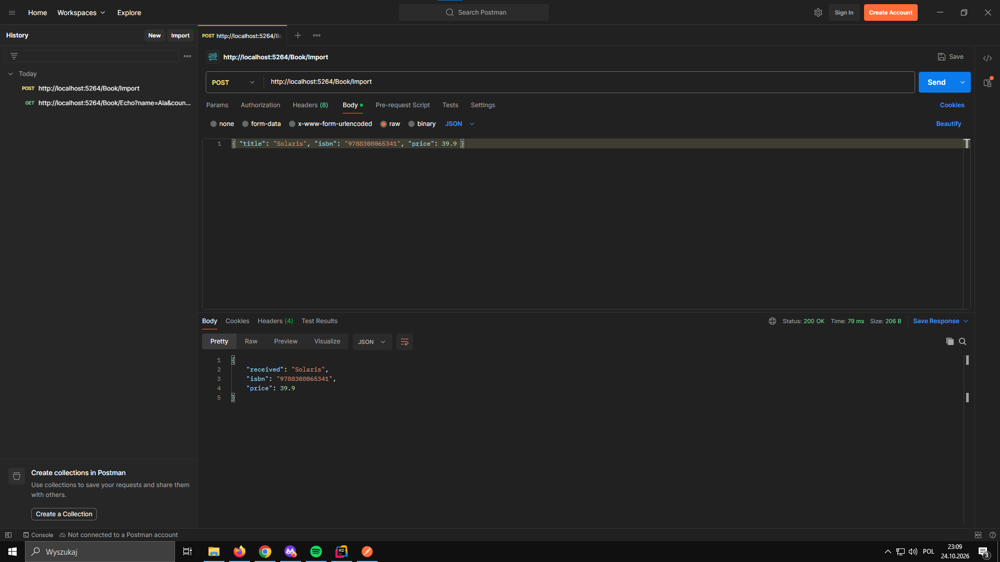
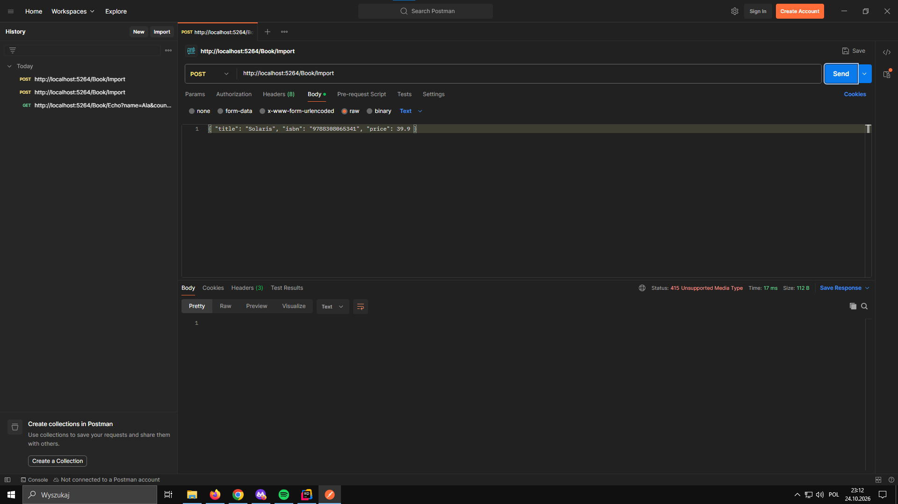

# Lab 1
## Część B
| Pytanie | Odpowiedź |
| :--- | :--- |
| Metoda żądania | GET |
| Kod statusu odpowiedzi | 200 OK |
| `Content-Type` odpowiedzi | text/html; charset=utf-8 |
| Nagłówek `User-Agent` żądania | Mozilla/5.0 (Windows NT 10.0; Win64; x64) AppleWebKit/537.36 (KHTML, like Gecko) Chrome/155.0.0.0 Safari/537.36 |
| Ile żądań wykonała strona łącznie i dlaczego więcej niż jedno? | Strona wykonała 9 żądań. Pierwsze żądanie pobiera dokument HTML strony głównej, a podczas jego analizy przeglądarka wykrywa odwołania do zasobów zewnętrznych i wysyła osobne żądania|

3. Po wejściu na adres /abc pojawia się kod statusu 404 Not Found

## Część C 
Zadanie C1:
- `/Book/Status?code=404` - W Network status 404 Not Found, przeglądarka wyświetla wbudowaną stronę że nie można znaleźć danej strony
- `/Book/Status?code=418` -  W Network status 418 I'm a teapot, przeglądarka wyświetla wbudowaną stronę: Ta strona nie działa
- `/Book/Status?code=500` - W Network status 500 Internal Server Error, przeglądarka wyświetla wbudowaną stronę: Ta strona nie działa
- `StatusCode(404)` - Nie pokazuje strony błędu aplikacji

## Zrzuty ekranu

### Zakładka Network

### Postman

